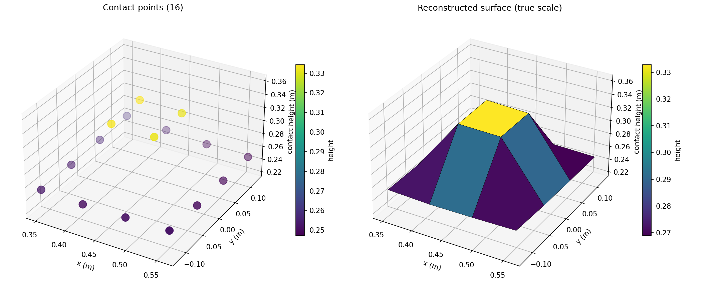

# UR Touch Mapping

**A robot arm that figures out the shape of an object by touching it, with no camera.**

Cockroaches find their way in the dark by feeling things with their antennae. This project gives
a Universal Robots arm an antenna too: a metal ruler. The arm taps the ruler down on 16 spots and
writes down how high each touch was. Put those 16 heights together and you get a 3D picture of
what's on the table.

[](https://youtube.com/shorts/YOUTUBE_VIDEO_ID)

▶️ **[Watch the 3-minute explainer](https://youtube.com/shorts/YOUTUBE_VIDEO_ID)**

## Result



In this real run, the arm checked an area of 21 cm × 24 cm, roughly the size of a sheet of paper.
In the middle it found an object about **8 cm tall**: the touches there stopped 8 cm higher than
the touches on the bare table. All 16 spots registered a touch. The raw numbers are in
[`data/touch_map_log.csv`](data/touch_map_log.csv).

## What it's made of

- **The arm:** a Universal Robots arm. Its wrist can feel force, which is how it knows it touched
  something.
- **The antenna:** a metal ruler held in the gripper. Its tip sticks out 15.7 cm past the end of
  the arm.
- **The brain:** an NVIDIA Jetson Nano, a computer about the size of your hand. It runs all the
  code.
- **How they talk:** ROS 2, a system that lets robot parts send messages to each other. The Jetson
  tells the arm where to go. The arm sends back where it is and how much force it feels.

## How it works (3 steps)

**1. Plan every move first:** [`scripts/solve_grid.py`](scripts/solve_grid.py)

The arm has six joints. For each of the 16 spots, this script works out the angle every joint
needs so the ruler ends up right above that spot. It does this at 6 heights, from 30 cm above the
table down to the table. (It asks MoveIt, a motion-planning tool for ROS, to do the math.) If an
answer would make a joint suddenly swing a long way, it's thrown out, so the arm can't twist into
a strange pose halfway down. The plan is saved to [`data/grid_poses.csv`](data/grid_poses.csv).

**2. Touch each spot:** [`scripts/touch_map.py`](scripts/touch_map.py)

At each spot, the arm first holds still in the air for 1 second and measures the force. That's
its "nothing touching" reading. Then it lowers slowly. When the ruler presses on something, the
table pushes back up on it, and the force reading drops. As soon as it drops more than 1 newton
(about the weight of a small apple) below the "nothing touching" reading, the arm knows it hit
something. It stops and records its height.

**3. Draw the result:** [`scripts/plot_map.py`](scripts/plot_map.py)

Turns the 16 heights into a 3D plot. The height axis is fixed at 15 cm, so the shape is shown at
its real proportions instead of being stretched.

## Folders

```
scripts/      the 3 steps: solve_grid -> touch_map -> plot_map
data/         the planned joint angles and the recorded touches
media/        the result picture
```

## Running it

You need ROS 2, the
[Universal Robots ROS 2 driver](https://github.com/UniversalRobots/Universal_Robots_ROS2_Driver),
and MoveIt running. I ran everything on the Jetson Nano, but any Linux computer with ROS 2 that
can reach the arm over the network works. Run each script from the main folder of the repo:

```bash
python3 scripts/solve_grid.py   # plan the moves (needs MoveIt)
python3 scripts/touch_map.py    # moves the real arm. Keep the emergency stop within reach!
python3 scripts/plot_map.py     # draw the result (only needs numpy + matplotlib)
```

To redraw the plot from the saved data without a robot, all you need is Python:

```bash
pip install -r requirements.txt
python3 scripts/plot_map.py
```

Settings you might need to change:

- `FINGER_LENGTH` in `solve_grid.py`: how far the ruler tip sticks out past the arm (0.157 m here)
- `FORCE_THRESHOLD` in `touch_map.py`: how big a force drop counts as a touch (1 newton here)
- `DRY_RUN` in `touch_map.py`: set to `True` to only report touches without stopping the arm (for
  testing)

## Limits

- The saved heights are for the end of the arm (`tool0`), not the ruler tip. To get the tip's
  height, subtract `FINGER_LENGTH`. Differences between spots, like the 8 cm object above, are
  still correct, because every spot has the same offset.
- 16 spots, 7–8 cm apart, give a rough picture, like a photo with only 16 pixels. The sloped
  sides in the plot come from connecting neighboring dots, not from the real object. More spots
  would give sharper edges.
