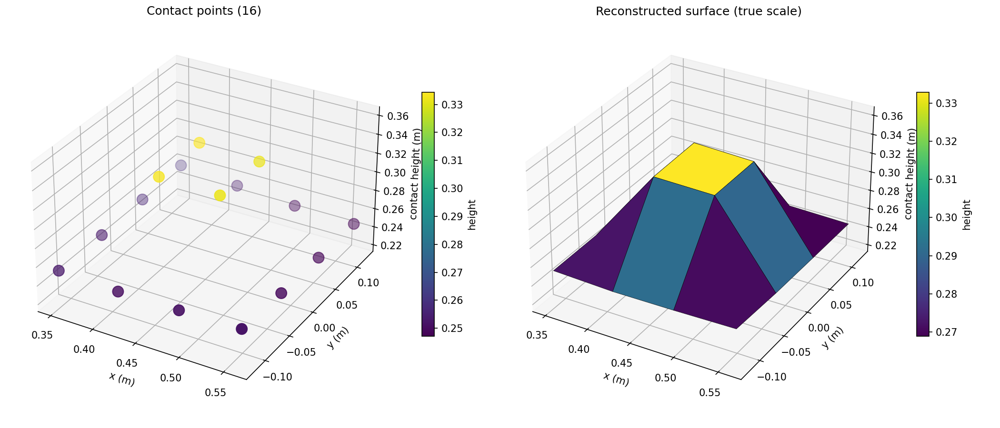

# UR Touch Mapping

A Universal Robots arm that **maps the shape of an object by touch alone**, with no camera.
The arm lowers a probe onto a 4 × 4 grid of points. It watches the wrist force sensor and
stops the moment it feels contact. Then it records how high it was when it stopped. Those 16
heights become a 3D map of whatever is on the table.

[](https://youtube.com/shorts/YOUTUBE_VIDEO_ID)

▶️ **[Watch the 3-minute explainer](https://youtube.com/shorts/YOUTUBE_VIDEO_ID)**

## Result



This map came from a run on the real robot. The arm probed a 21 cm × 24 cm area and found an
object in the middle of the grid. The probe touched the object's top about **8 cm higher**
than the surrounding table (0.333 m vs 0.250 m flange height). All 16 points registered a
contact. The raw numbers are in [`data/touch_map_log.csv`](data/touch_map_log.csv).

## How it works

1. **Plan the motions ahead of time** with [`scripts/solve_grid.py`](scripts/solve_grid.py).
   For each grid point it asks MoveIt's inverse-kinematics service for the joint angles that
   put the fingertip there. It does this at 6 heights, from 30 cm down to the table. Each
   solution is seeded from the previous one, and any solution where a joint would jump too far
   is rejected. That keeps the arm from flipping into a strange pose partway down. The output
   is [`data/grid_poses.csv`](data/grid_poses.csv).
2. **Probe** with [`scripts/touch_map.py`](scripts/touch_map.py). At each point the arm
   hovers and averages the force reading for 1 second to get a "nothing touching" baseline.
   Then it descends slowly. When the force drops more than 1 N below the baseline, the arm is
   commanded to hold still, and its position is recorded from the TF transform tree.
3. **Plot** with [`scripts/plot_map.py`](scripts/plot_map.py). It draws the raw contact points
   and a reconstructed surface. The vertical axis uses a fixed 15 cm range, so heights are
   shown at true scale instead of being stretched.

## Repository layout

```
scripts/      final real-robot pipeline: solve_grid -> touch_map -> plot_map
data/         planned joint angles and the logged contact results
media/        result figure
```

## Running it

Requires ROS 2 with the [Universal Robots ROS 2 driver](https://github.com/UniversalRobots/Universal_Robots_ROS2_Driver)
and MoveIt running. Run every script from the repository root:

```bash
python3 scripts/solve_grid.py   # needs MoveIt's /compute_ik service
python3 scripts/touch_map.py    # moves the real arm. Keep the e-stop in reach
python3 scripts/plot_map.py     # only needs numpy + matplotlib
```

Settings you may need to change: `FINGER_LENGTH` in `solve_grid.py` (the distance from the
tool flange to the probe tip; 0.157 m here), and `FORCE_THRESHOLD` / `DRY_RUN` in
`touch_map.py`.

## Notes and limitations

- Heights are recorded at the tool flange (`tool0`), not at the probe tip. Subtract
  `FINGER_LENGTH` to get the tip height. Height *differences* between points, like the object
  height above, are unaffected.
- With points spaced 7–8 cm apart, the map is coarse. The sloped sides in the surface plot come from
  joining neighboring points, not from the real object. A denser grid would show sharper edges.
